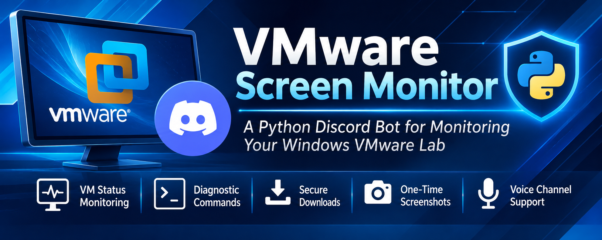
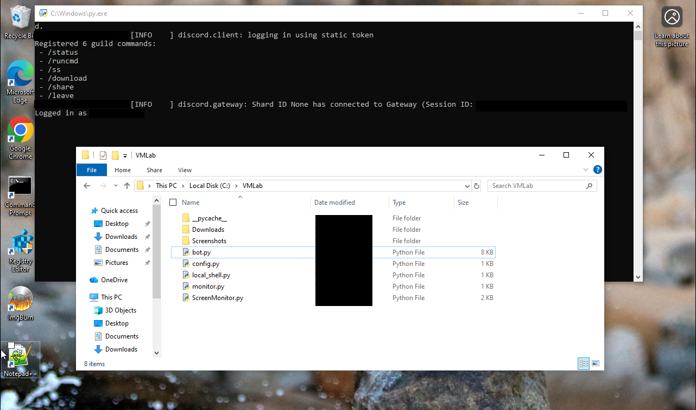
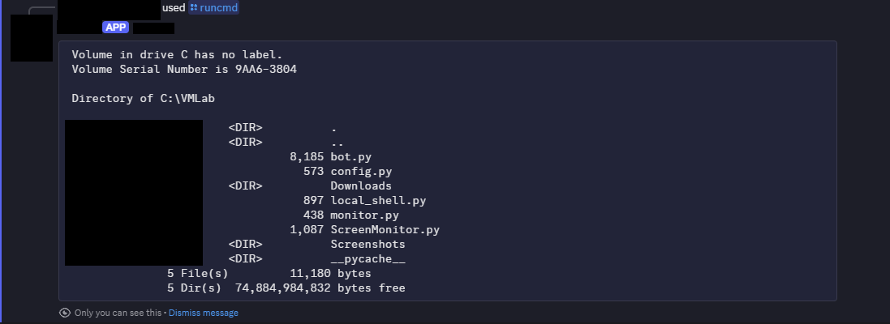

# VMware Screen Monitor

<p align="center">
  
</p>

<p align="center">
  A Python-based Discord monitoring bot for Windows VMware lab environments.
</p>

<p align="center">
  
  
  
  
</p>

## Overview

**VMware Screen Monitor** is a Python project designed to monitor and interact with a Windows virtual machine through a Discord bot.

It provides a central Discord interface for authorized lab monitoring, diagnostic operations, and screenshot workflows.

## Screenshots

### Windows VMware Environment



### Discord Command Output



## Features

- Discord bot integration
- Windows VM monitoring
- System status reporting
- Diagnostic command interface
- Screenshot workflow
- HTTPS file downloads
- Discord voice channel connection
- Webhook notifications

## Discord Commands

| Command | Description |
|---|---|
| `/status` | View system monitoring information |
| `/runcmd` | Run supported diagnostic commands |
| `/ss` | Start the screenshot workflow |
| `/download` | Download a file from an HTTPS URL |
| `/share` | Connect the bot to a voice channel |
| `/leave` | Disconnect the bot from a voice channel |

Some commands may require additional configuration or permissions.

## Project Structure

```text
VMware-Screen-Monitor/
│
├── assets/
│   ├── banner.png
│   ├── example.png
│   └── example2.png
│
├── Downloads/
├── Screenshots/
│
├── bot.py
├── config.py
├── local_shell.py
├── monitor.py
├── ScreenMonitor.py
│
├── README.md
├── LICENSE
├── requirements.txt
└── .gitignore
```

## Requirements

- Windows 10 or later
- Python 3.10 or later
- VMware virtual machine
- Discord account
- Discord bot application

## Installation

### 1. Clone the repository

```bash
git clone https://github.com/TomoBao/VMware-Screen-Monitor.git
```

### 2. Open the project directory

```bash
cd VMware-Screen-Monitor
```

### 3. Install dependencies

```bash
pip install -r requirements.txt
```

### 4. Configure the bot

Create your local `config.py` using the example configuration.

Set the required Discord bot token, webhook URL, and channel IDs.

### 5. Start the bot

```bash
python bot.py
```

## Configuration

Keep your configuration private.

Never publish:

- Discord bot tokens
- Webhook URLs
- Private channel or server information
- Other credentials

Use placeholder values in any example configuration committed to GitHub.

## Security

This project is intended for authorized VMware lab environments.

- Only monitor systems you own or have permission to monitor.
- Keep diagnostic operations restricted.
- Make screenshot capture visible and require local confirmation.
- Do not automatically execute downloaded files.
- Protect Discord credentials and webhooks.
- Avoid exposing private information in screenshots or logs.

## Contributing

Contributions, suggestions, and bug reports are welcome!

Feel free to open an issue or submit a pull request.

## License

This project is licensed under the MIT License. See [LICENSE](LICENSE) for details.

---

<p align="center">
  Made with Python by <a href="https://github.com/TomoBao">TomoBao</a>
</p>
