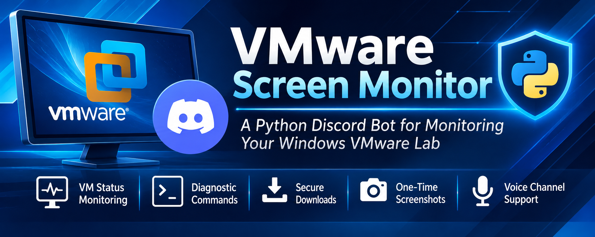
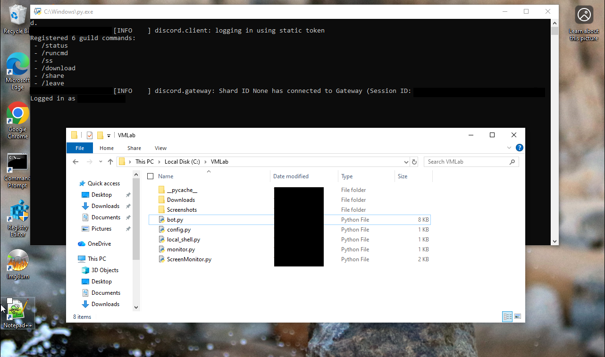
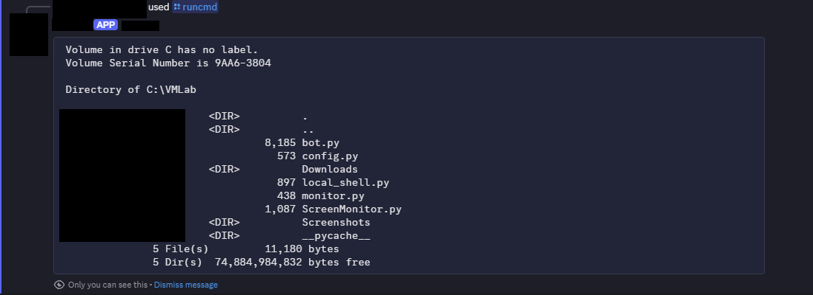

# VMware Screen Monitor

<p align="center">
  
</p>

<p align="center">
  <strong>A Python-based Discord monitoring project for Windows VMware environments.</strong>
</p>

<p align="center">
  
  
  
  
  
</p>

---

## About

**VMware Screen Monitor** is an open-source Python project designed to monitor and perform authorized diagnostic operations on Windows VMware virtual machines through Discord.

The project provides a Discord bot interface for accessing system information and supported monitoring features on your configured Windows VM.

**Default project directory:**

```text
C:\VMLab
```

## Screenshots

### VMware Windows Environment



### Discord Bot



## Features

- Discord bot integration
- Windows system monitoring
- CPU, RAM, and disk usage reporting
- Predefined diagnostic commands
- Screenshot capture with local confirmation
- HTTPS file downloading
- Discord voice channel connection
- Optional webhook notifications

## Discord Commands

| Command | Description |
|---|---|
| `/status` | Display Windows system status |
| `/runcmd` | Run supported diagnostic commands |
| `/ss` | Request the local screenshot workflow |
| `/download` | Download a supported file from an HTTPS URL |
| `/share` | Connect the bot to a Discord voice channel |
| `/leave` | Disconnect the bot from a voice channel |

### Supported Diagnostic Commands

The `/runcmd` command supports:

- `hostname`
- `whoami`
- `ipconfig`
- `tasklist`
- `systeminfo`
- `dir`

**Note:** `/share` connects the bot to voice chat. It does not provide desktop screen sharing.

## Requirements

- Windows 10 or later
- Python 3.10+
- VMware Workstation or a compatible VMware environment
- Git
- Discord account
- Discord bot application

## Installation

### 1. Clone the repository

Open PowerShell or Command Prompt:

```powershell
git clone https://github.com/TomoBao/VMware-Screen-Monitor.git C:\VMLab
```

### 2. Open the project folder

```powershell
cd C:\VMLab
```

### 3. Install Python dependencies

```powershell
python -m pip install --upgrade pip
python -m pip install -r requirements.txt
```

### 4. Configure the project

Create your local `config.py` using the example configuration:

```powershell
Copy-Item config.example.py config.py
```

Configure the required settings in `config.py`:

- Discord bot token
- Discord server ID
- Control channel ID
- Webhook URL, if required by your enabled features
- Other settings required by your installed version

**Never publish your actual credentials.**

### 5. Start the bot

Make sure your terminal is inside `C:\VMLab`.

Run:

```powershell
python bot.py
```

The bot should connect to Discord and register its server slash commands.

## Project Structure

```text
C:\VMLab
│
├── assets/
│   ├── banner.png
│   ├── example.png
│   └── example2.png
│
├── Downloads/
├── Screenshots/
├── logs/
│
├── bot.py
├── config.example.py
├── config.py (local, not tracked)
├── local_shell.py
├── logger.py
├── monitor.py
├── screenmonitor.py
├── webhook.py
│
├── requirements.txt
├── README.md
├── LICENSE
└── .gitignore
```

**Windows compatibility note:** The repository currently contains both `ScreenMonitor.py` and `screenmonitor.py`. These names collide on case-insensitive Windows filesystems. A future cleanup will resolve this; do not assume both files can coexist in a Windows checkout.

## Configuration

The project uses `config.py` for local configuration.

Keep the following information private:

- Discord bot token
- Discord webhook URL
- Private server and channel IDs
- Other credentials

For public GitHub distribution, include a sanitized `config.example.py` instead of your private `config.py`.

The `.gitignore` file should exclude private configuration, credentials, logs, and generated files.

## Security

This project is intended for authorized Windows VMware lab environments.

- Only monitor machines you own or have permission to access.
- Keep diagnostic commands restricted to supported operations.
- Require visible local confirmation before screenshot capture.
- Review downloaded files before opening them.
- Never automatically execute downloaded files.
- Protect Discord tokens and webhook URLs.
- Avoid publishing private information in screenshots or logs.
- Keep your Discord server access restricted to trusted users.

## Contributing

Contributions are welcome!

You can help improve VMware Screen Monitor by:

- Reporting bugs through GitHub Issues.
- Suggesting new features.
- Submitting pull requests.
- Improving documentation.

Please do not include credentials or private information in public issues.

## License

VMware Screen Monitor is licensed under the **MIT License**.

See the [LICENSE](LICENSE) file for the full license text.

## Repository

GitHub: [TomoBao/VMware-Screen-Monitor](https://github.com/TomoBao/VMware-Screen-Monitor)

---

<p align="center">
  Made with ❤️ and Python by <a href="https://github.com/TomoBao">TomoBao</a>
</p>
